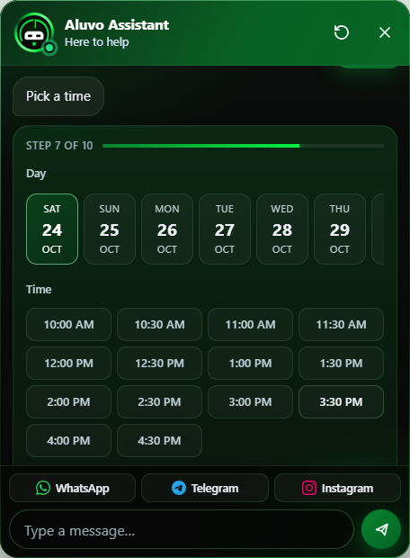
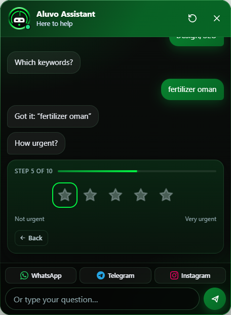
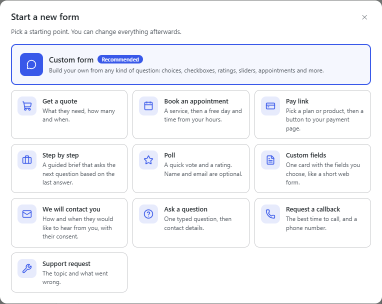
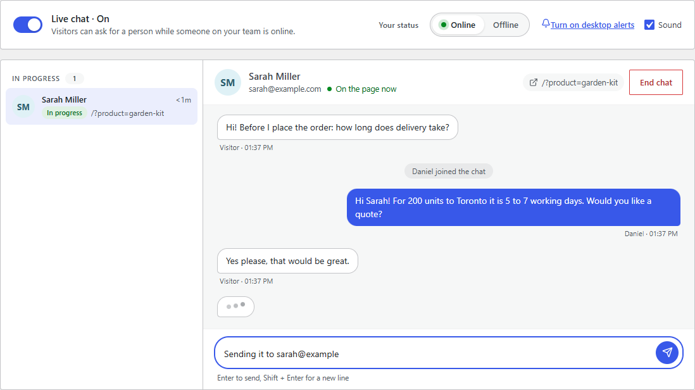
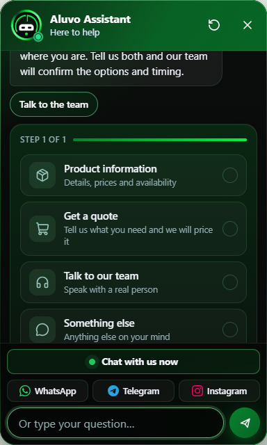
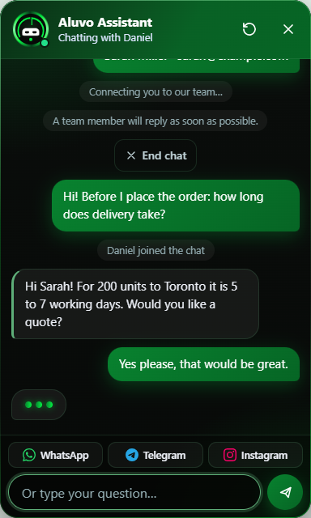
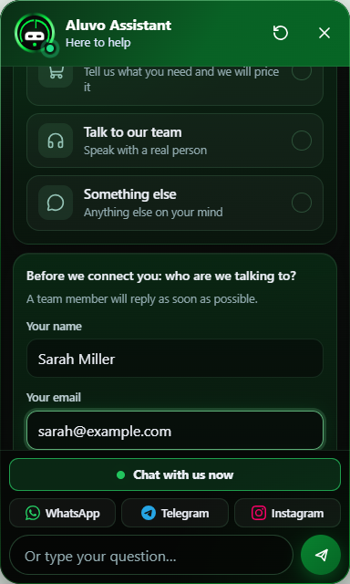

  

<h1 align="center">Aluvo Chat</h1>

  A chat assistant for WordPress that guides visitors through your own forms 
  and hands every request to your team: inbox, WhatsApp, Telegram and more.

  <b>Free 2.2.0</b> · <b>Pro add-on 2.2.0</b> · WordPress 5.3+ · PHP 7.2+ · Follows your WordPress language

---

> **This repository is a showcase.** It documents the plugin and its progress.
> The source code is private. If you'd like Aluvo Chat on your site, see [Get it](#get-it).

  
  &nbsp;&nbsp;
  

## What it does

- **Guided conversations.** Visitors pick what they need (product information, a quote, a word with your team) and the chat walks them through the steps you defined.
- **A form builder, not a script.** Start from a template, pick an icon, and build any flow from choices, typed answers, form fields, quantities and contact details, with a live preview beside it.
- **Every channel you use.** WhatsApp, Telegram, Messenger, Instagram, LinkedIn, Discord, GitHub, email or a custom link, each with its own icon.
- **Nothing gets lost.** Every request is saved in WordPress first, then emailed, and WhatsApp or email can open with the whole request already written.
- **Built for real sites.** The chat renders in its own isolated layer, so theme CSS can't break it and it can't break the theme. On phones it sits under your menu until it's opened, then above everything.

## Free and Pro

The free plugin is complete on its own. Pro is an add-on that installs beside it.

| | Free | Pro |
|---|:---:|:---:|
| Unlimited forms and requests | ✓ | ✓ |
| Checkboxes, yes or no, ratings, sliders, appointments, consent and payment links in forms | ✓ | ✓ |
| Steps that appear only when an earlier answer matches | ✓ | ✓ |
| Contact buttons and bottom bar with brand icons | ✓ | ✓ |
| Requests saved in WordPress and emailed | ✓ | ✓ |
| Colour and gradient themes, button shapes, six border types, inside colour or gradient, phone settings | ✓ | ✓ |
| Follows your WordPress language, including right-to-left | ✓ | ✓ |
| Live chat: answer visitors yourself, right in the chat window | | ✓ |
| AI answers with your own Claude or OpenAI key | | ✓ |
| Ready answers with synonyms, typo tolerance and trigger words in other languages | | ✓ |
| Products & categories: your own or live from WooCommerce, with price, offer, tags and a buy button | | ✓ |
| Five button animations | ✓ | ✓ |
| Five more animations in your own colour, with a separate choice for phones | | ✓ |
| Custom CSS with a guide to every selector | | ✓ |
| No "Powered by" link (opt-in on Free) | | ✓ |

Pro is unlocked with a license key that is checked on your own server: no account, no tracking, nothing sent anywhere. If a subscription ends, Pro switches off and Free keeps working, with everything you set up kept for renewal.

## Contact channels

Fill in the channels you use, then choose which appear as **contact buttons** (when a visitor wants a person, after a request, and when the chat has no answer) and which three sit in the **bottom bar**.

## Multi-language support

The plugin follows the language set in WordPress, including right-to-left languages, and can be translated into any language.

## The dashboard

An overview with requests per day, top forms, products and countries, and a checklist that shows what still needs setting up.

### Appearance with a live preview

Every change shows instantly on a light page, a dark page, a phone and the open chat window, drawn with the same markup and stylesheet visitors get.

On Free, each Pro animation shows as a card with a looping preview, and each Pro screen shows a picture of how it looks with Pro.

### The chat button

Three shapes and six border types on Free: gradient, solid, dashed, dotted, double and neon. Every card is a live demo of the real button.

Inside the border: the theme's own colour, a colour of your choice, a two-colour gradient, or transparent.

### Animations

Five animations come free: Spinning border, Floating, Ripple rings, Comet and Hello wave. Pro adds Heartbeat, Breathing glow, Attention bounce, Orbit and Shine sweep, an animation colour of your own, and a separate animation for phones.

### Forms

Forms, steps and a preview side by side. New forms start from a template, each form gets an icon from a gallery, and every field explains itself.

Fourteen kinds of question, all free: multiple choice, checkboxes, yes or no, typed answers, form fields, star ratings, sliders for a budget or any number, appointments that offer only free days and times from your hours, a consent box with a link to your policy, a payment or link button, quantities, and product steps. Any step can be set to appear only when an earlier answer matches, so a form asks for a date only if the visitor has a deadline.

  
  &nbsp;
  

  
  

### Live chat (Pro)

While someone on your team is online, visitors see "Chat with us now" above the message box and talk to a person without leaving the chat. You answer from the dashboard: what the visitor already told the chat comes first, so nobody has to repeat themselves. A sound, a desktop alert and a count in the tab title tell you when someone is waiting, and both sides see when the other is typing.

  
  &nbsp;
  

Visitors give their name and email first, and are told you reply as soon as possible during your working hours.

  

Support staff do not need to be administrators: give them the Live chat agent role and they see the Live chat screen and nothing else, landing on it when they log in. Editors, shop managers or any other role can be allowed too, and a Live chat item in the admin bar shows how many visitors are waiting. One switch at the top of the screen turns live chat off for everyone.

Set working hours, or just switch yourself online. If nobody answers in time, the visitor is offered your contact buttons and you get an email. The chat carries on as the visitor moves between pages, and conversations are covered by WordPress's Export and Erase Personal Data tools.

### Products & categories (Pro)

Add your own products or link them from WooCommerce. A linked product keeps its shop name, price, sale, picture and page up to date; anything typed here only changes what the chat shows.

  
  &nbsp;
  

### Answers (Pro)

Each answer reads like the chat itself. Trigger words are chips, and words in other languages have their own list.

### Gradient themes

Solid and gradient themes, or your own two colours and angle. The gradient runs across the header, the buttons and the visitor's messages. The inside of the chat button can follow the theme, take any colour, or be transparent.

### Custom CSS with a built-in guide (Pro)

## Security and privacy

- Every post from the chat carries a short-lived token signed with the site's own keys. Request tokens are single-use.
- Posts from other websites, oversized bodies and non-JSON bodies are refused before anything is read.
- Limits per visitor and daily ceilings for the whole site, for requests and for AI answers.
- Answers are checked against the saved form on the server. Prices and totals are never taken from the browser.
- The AI key (Pro) is encrypted at rest and never sent to browsers.
- IP addresses are used only for rate limits and never stored. WordPress's Export and Erase Personal Data tools cover chat requests.
- The free plugin passes WordPress's official Plugin Check with no errors.

## Progress

See the [changelog](CHANGELOG.md) for what changed in each release.

## Get it

Pro, pricing and downloads: **[digidev.pro/aluvo-chat](https://digidev.pro/aluvo-chat)**.

For a demo or a setup on your site, email **[Chaosmp81@gmail.com](mailto:Chaosmp81@gmail.com)**.

---

Designed and built by <b>NERFLESS</b> · © 2026

